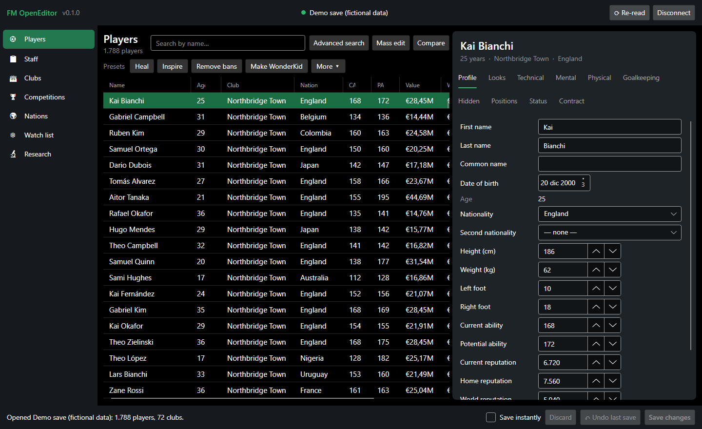
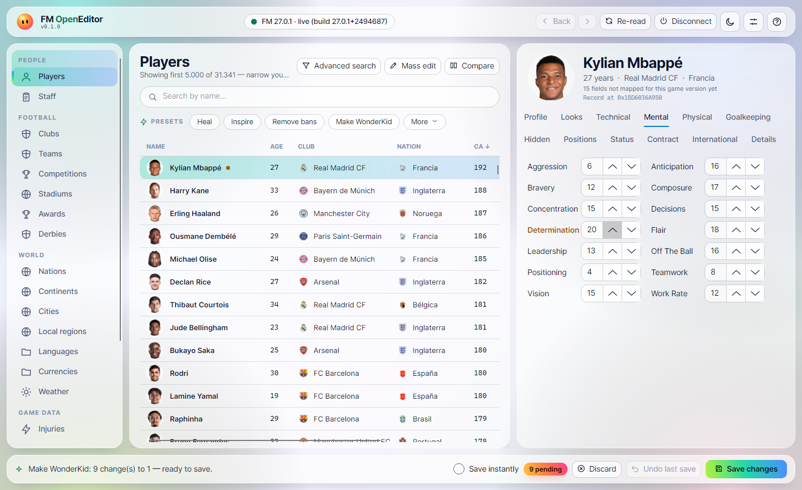
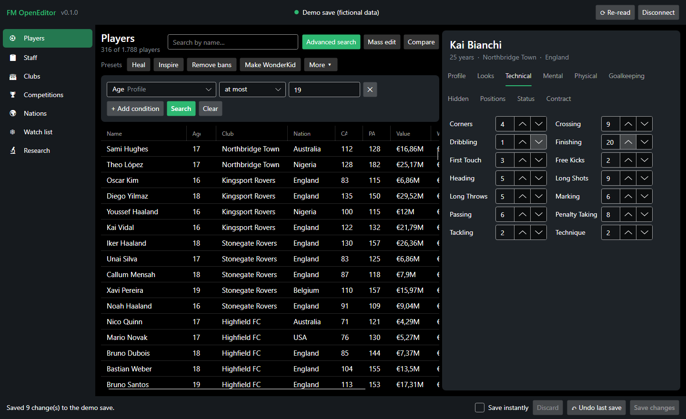
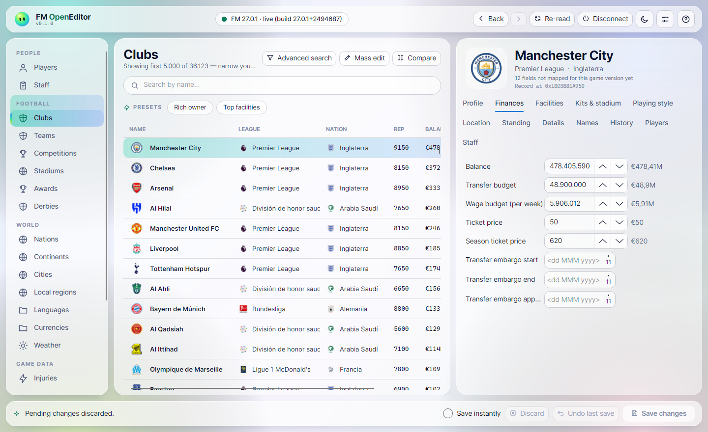
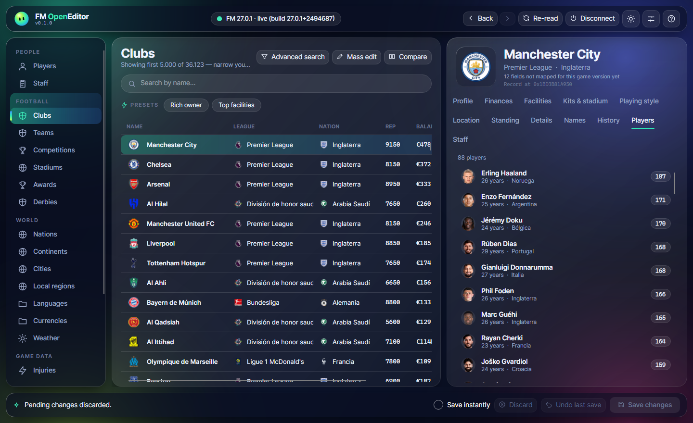
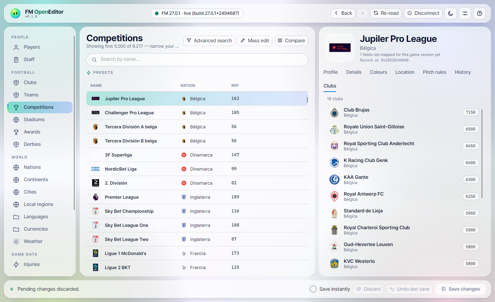

<div align="center">


# FM OpenEditor

### Your save, your rules.

**A free, open-source, real-time editor for Football Manager 2027.**<br>
Open it next to the game, change what you like, save, and keep playing.

<br>

<a href="https://github.com/ElMariones/FM_EDITOR/releases/latest/download/FMOpenEditor-win-x64.zip">
  
</a>

<sub>Windows 10 / 11 · 64-bit · free · nothing else to install · <a href="https://github.com/ElMariones/FM_EDITOR/releases">all versions</a></sub>

<br><br>

[](https://github.com/ElMariones/FM_EDITOR/releases/latest)
[](https://github.com/ElMariones/FM_EDITOR/stargazers)
[](LICENSE)

</div>

<br>



<sub>All screenshots are from a real FM27 save, captured while the game was running. Faces and badges come from the player's own graphics packs.</sub>

## Get started in 2 minutes

### What you need

| | |
|---|---|
| 💻 **Windows 10 or 11, 64-bit** |
| ⚽ **Football Manager 2027** on PC |
| 📦 **About 100 MB of free space** |

### Step by step

1. **Download** the zip with the green button above.
2. **Unzip it.** Right-click `FMOpenEditor-win-x64.zip` → **Extract All…** → **Extract**. Put the folder anywhere you like: Desktop, Documents…
3. **Start Football Manager 2027** and load your save.
4. **Open the folder and double-click `FMOpenEditor.exe`.**
5. Click **Connect to Football Manager**. Browse, edit, then press **Save changes**. The game picks the change up straight away.

> [!TIP]
> **Windows says "Windows protected your PC"?** That's Windows SmartScreen. It shows for any new app that isn't code-signed yet. Click **More info**, then **Run anyway**. You only need to do this once. The full source code is right here if you want to check what it does.

> [!NOTE]
> **It says Football Manager isn't running, but it is?** If the game runs as administrator, FM OpenEditor needs to as well: right-click `FMOpenEditor.exe` → **Run as administrator**.

## What you can do

### Edit any player, live

Every attribute, current and potential ability, positions, reputation, condition, morale, contract and more. Changes wait as **pending** until you press **Save changes**, and **Undo last save** takes them back. Tick **Save instantly** to skip the waiting.



### One-click presets

**Heal**, **Inspire**, **Remove bans**, **Make WonderKid**, **Rich owner**, **Top facilities**, **Remove Brexit**, **Trained at current club**, **Release on a free**… Select one row or a hundred, and click. Presets are plain JSON files in [`presets/`](presets), so you can write your own and share them.

### Find anyone

Search by name, or open **Advanced search** and filter by any field: age, nationality, ability, contract expiry… Then **Mass edit** everyone in the result at once: set, add, multiply, raise to at least, lower to at most.



### Run the club

Balance, transfer and wage budgets, ticket prices, facilities, reputation, kits, stadium and league standing.

| Finances | Squad |
|---|---|
|  |  |

### The whole database, linked

Players, staff, clubs, competitions, stadiums, awards, derbies, nations, cities, regions, languages, currencies, injuries and more: **17 record types and around 540 fields**.



### And also

- **Freeze or only-up**: lock a player's attributes, or let them improve but never decline, while the game runs.
- **Compare** two players side by side, with the better value highlighted.
- **Transfers**: move a player to any club, now or on a future date, with a fee (taken from the buyer and paid to the seller) and a new wage and contract. Right-click a player, or use the Transfer button on their page. The game's Career screen isn't updated: the current season shows under the new club, with no fee.
- **Nation rules**: EU free movement, work permits and non-EU limits.
- **Your faces and badges**: player faces, club badges, competition logos and flags from your own FM graphics folder. No pack? You just see names.
- **Day and night themes**, or follow Windows.
- **Your currency**: amounts show in euros, pounds or dollars, or any other currency in your save, at the save's own exchange rate.
- **Research tools** for contributors mapping new game versions: value, string and pointer scans, an RTTI class finder, record snapshot/diff and a field correlator.

## How AI helped map the game

Football Manager doesn't publish where it keeps its data in memory. Finding that out (the "mapping") is the hard part of any editor, and it's usually slow, manual work: change a value in the game, scan memory for it, repeat, one field at a time.

FM OpenEditor's FM27 mapping was done with the help of Claude, working with me on my own machine against my own game.

The result is the definition file [`definitions/fm27-27.0.1.json`](definitions/fm27-27.0.1.json): 18 record types and roughly 540 fields. Everything was reviewed and tested by hand, and every step is documented in [addresses.md](addresses.md) so anyone can check it or redo it after a patch. No data was copied from any other editor.

> [!WARNING]
> **Back up your save before editing**, and use it in **single-player** careers only. FM OpenEditor never touches your game files on disk; it only reads and writes the running game's memory, and only when you save.
If something looks wrong, please [open an issue](https://github.com/ElMariones/FM_EDITOR/issues/new).

## A community project

FM OpenEditor is **free, nonprofit and open source**, and it gets better with every person who joins in. You don't need to code to help.

- ⭐ **Star the repo.** It's free, and it helps other FM players find the project.
- 🐛 **[Report a bug or suggest a feature](https://github.com/ElMariones/FM_EDITOR/issues).** Tell us what you did, what you expected and what happened.
- 🧪 **Test fields in game** and tell us which ones work. That's how fields become "verified".
- 🍴 **Fork it** and send a pull request: code, new game versions, translations, docs.
- 🗺️ **Map a new patch.** When FM updates, the [research tools](tools/research) and [docs/DEFINITIONS.md](docs/DEFINITIONS.md) show how to bring the offsets up to date. No code changes needed, just numbers.

Start with [CONTRIBUTING.md](CONTRIBUTING.md).

## Build from source

For developers. You need the [.NET 10 SDK](https://dotnet.microsoft.com/download).

```bash
git clone https://github.com/ElMariones/FM_EDITOR.git
cd FM_EDITOR
dotnet run --project src/FMOpenEditor.App
```

```bash
dotnet test
```

`--demo` opens a generated, fictional database for development and tests (`dotnet run --project src/FMOpenEditor.App -- --demo`).

**How it's built:** C# / .NET 10 with an [Avalonia](https://avaloniaui.net/) UI. `src/FMOpenEditor.Core` holds memory access, data-driven game definitions, the editing session (pending changes, save, undo), presets, search and freeze/only-up, with no UI dependencies. `src/FMOpenEditor.App` is the desktop app. `tests/` has unit tests, including the memory engine running against a fake game, and headless UI tests that drive the real window. More in [docs/ARCHITECTURE.md](docs/ARCHITECTURE.md).

## Legal

FM OpenEditor is an independent fan project. It is not affiliated with, endorsed by or connected to Sports Interactive, SEGA, or the makers of any other editor. "Football Manager" is a trademark of its owners. All code here is original. Please don't contribute code, data or offset tables copied from closed-source tools.

Licensed under the [GNU GPL v3.0 or later](LICENSE): free to use, study, share and improve, and it stays that way.

<div align="center">
<br>

Developed by **[Mario Landaburu](https://github.com/ElMariones)** and the FM OpenEditor community.

</div>
